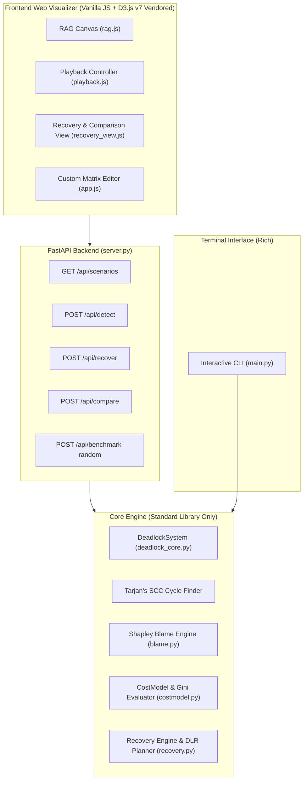

# Deadlock Detection & Recovery: Resource Allocation Graph Visualizer

> **Operating Systems (BCSE303L) Course Project**  
> **Team Members**:
> - **Sri Krishna** (24BCE2630)
> - **Rithvik Ravi** (24BCE2254)
> - **Aditya** (24BCE2242)

[](https://www.python.org/downloads/)
[](https://fastapi.tiangolo.com/)
[-orange.svg)](https://d3js.org/)
[]()
[](https://github.com/astral-sh/ruff)

---

## 📌 Project Overview

This suite is a comprehensive, end-to-end systems implementation of **Multi-Instance Deadlock Detection & Recovery**, featuring an interactive D3.js **Resource Allocation Graph (RAG) visualizer**, three classical recovery strategies, and a novel proposed recovery paradigm: **Debt-Ledger Recovery (DLR)**.

### Three Phases of Engineering:
1. **Phase 1: Core Detection Engine & CLI**:
   - Exact implementation of the Silberschatz, Galvin & Gagne multi-instance detection algorithm ($O(m \cdot n^2)$).
   - Tarjan's Strongly Connected Components (SCC) algorithm for detecting concrete deadlock cycles.
   - Interactive Rich-based CLI with step-by-step viva explanation mode.
   - 5 Curated benchmark scenarios (`safe`, `deadlocked`, `borderline`, `circular`, `zero_alloc`).
2. **Phase 2: Interactive D3.js RAG Visualizer**:
   - Zero-build web visualizer using vendored D3.js v7 (strictly zero external CDN runtime dependencies).
   - Multi-instance resource nodes (sub-dots for allocated and available instances).
   - Solid allocation arrows, dashed request arrows, and pulsing crimson deadlock cycle glows.
   - Full playback controller (play, pause, step forward/back, scrubber slider, 0.25x–4x speed, keyboard shortcuts).
   - Custom Matrix Editor with dynamic rows/columns and live validation.
3. **Phase 3: Recovery Engine, Shapley Blame & DLR**:
   - **Classical Strategies**: Abort-All, Abort-One-by-One (aging penalty), Resource Preemption with Rollback.
   - **Novel Strategy: Debt-Ledger Recovery (DLR)**:
     - In-place process suspension (zero work loss, rollback = 0).
     - Unit-granular minimal lend plan ($L[i][j]$) driven by the game-theoretic **Shapley Blame Index**.
     - Formally verified **Repayment Safety** via ledger-augmented detection.
     - Event-driven Repayment Router with Debt Ledger IOUs.
     - Fallback aborts restricted exclusively to mathematically over-subscribed processes.
   - Multi-strategy comparison dashboard with fairness scores ($1 - \text{Gini}$) and a 200-random-systems Monte Carlo benchmark.

---

## 🏗️ Architecture Diagram



---

## 🚀 Quickstart & Installation

### 1. Requirements & Setup
Ensure Python 3.11+ is installed. Clone or navigate to the repository:

```bash
cd deadlock-suite
pip install -r requirements.txt
```

### 2. Run the Interactive CLI
```bash
# Run classic safe scenario
python main.py --scenario safe

# Run deadlocked scenario with step-by-step viva explanations
python main.py --scenario deadlocked --viva

# List all curated benchmark scenarios
python main.py --list

# Enter custom matrix interactively
python main.py --custom

# Run Debt-Ledger Recovery (DLR) directly from terminal
python main.py --scenario deadlocked --recover dlr

# Export detection report to JSON
python main.py --scenario deadlocked --export report.json
```

### 3. Launch the Web Visualizer
Start the FastAPI server:

```bash
python -m uvicorn server:app --reload --port 8000
```
Open your browser and navigate to:  
👉 **`http://localhost:8000`**

### 4. Run the Full Test Suite
Execute all 39 unit, property, and formal invariant tests:

```bash
pytest -v
```

---

## 📂 Repository Structure

```text
deadlock-suite/
├── core/
│   ├── __init__.py
│   ├── deadlock_core.py    # DeadlockSystem, AlgorithmStep, DetectionReport, Tarjan SCC
│   ├── recovery.py         # Classical strategies (Abort-All, Abort-One, Preempt) + DLR
│   ├── blame.py            # Game-theoretic Shapley Blame Index (exact & Monte Carlo)
│   └── costmodel.py        # Parameterized CostModel, metrics, and Gini fairness
├── demo_scenarios.py       # 5 Curated benchmark scenarios with viva notes
├── main.py                 # Interactive Rich-based CLI
├── server.py               # FastAPI application backend and static asset server
├── web/
│   ├── index.html          # Dark glassmorphic user interface (>= 1100px)
│   ├── style.css           # Modern theme, animations, cycle glows, responsive grid
│   ├── app.js              # Main frontend coordinator & custom matrix editor
│   ├── rag.js              # D3.js v7 Resource Allocation Graph renderer
│   ├── playback.js         # Step-by-step playback engine with scrubber
│   ├── recovery_view.js    # Recovery playback, Debt Ledger table, comparison charts
│   └── vendor/
│       └── d3.v7.min.js    # Vendored D3 v7 library (zero runtime CDN dependency)
├── tests/
│   ├── __init__.py
│   ├── test_deadlock.py    # Phase 1 tests + 500-instance random oracle property test
│   ├── test_blame.py       # Shapley game theory axioms (Efficiency, Symmetry, Null-Player)
│   └── test_recovery.py    # Formal P1-P6 invariants + 300 random deadlocked systems
├── docs/
│   ├── DECISIONS.md        # Architectural and technical decisions log
│   ├── VIVA_QA.md          # 26 Detailed viva questions & answers
│   └── RELATED_WORK.md     # Academic positioning of DLR vs existing literature
├── pyproject.toml          # Tooling configuration (Ruff linter, Pytest)
├── requirements.txt        # Python package dependencies
└── README.md               # Complete project documentation
```

---

## 🔬 Benchmark Scenarios

| Scenario Key | Description | Matrix Specs | Expected Outcome | Viva Highlight |
|---|---|---|---|---|
| `[safe]` | Classic Silberschatz benchmark | 5 processes, 3 resources (A,B,C) | Safe sequence: P0 → P2 → P1 → P3 → P4 | Demonstrates optimistic detection nature. |
| `[deadlocked]` | Classic variant with unmet demand | P2 requests [0,0,1] of C | Deadlocked: {P1, P2, P3, P4} | Illustrates cascade failure from 1 ungranted unit. |
| `[borderline]` | Cascade requiring rescan from 0 | 3 processes, 2 resources, Avail [0,1] | Safe sequence: P2 → P0 → P1 | Validates scan-order determinism and rescan. |
| `[circular]` | 2-process circular wait | P0 holds R0, needs R1; P1 holds R1, needs R0 | Immediate deadlock: {P0, P1} | Direct directed cycle in wait-for graph. |
| `[zero_alloc]` | Process with 0 allocated units | P0 holds [0,0], requests [5,5] | P0 finishes; Deadlocked: {P1, P2} | Proves why $Finish = True$ at start for 0-allocation. |

---

## 💡 Novel Contribution: Debt-Ledger Recovery (DLR)

### Theoretical Invariants Formally Verified:
- **P1 Safety**: The ledger-augmented state is proven deadlock-free before lending commences.
- **P2 Zero Loss**: No non-fallback process ever loses progress ($\text{rollback} = 0$).
- **P3 Conservation**: Total resources in existence remain strictly constant at every micro-step.
- **P4 Bounded Wait / Anti-Starvation**: Lender suspension duration is bounded by position in repayment order.
- **P5 Minimality**: In exact mode, no proper sub-plan can break the deadlock.
- **P6 Dominance**: DLR's total lost work is $\le$ Abort-One-by-One's lost work on all tested systems.

For full mathematical positioning, see [`docs/RELATED_WORK.md`](docs/RELATED_WORK.md).

---

## 👥 Course & Team Information

- **Course**: Operating Systems (BCSE303L)
- **Institution**: Vellore Institute of Technology
- **Team**:
  - **Sri Krishna** (Reg: `24BCE2630`)
  - **Rithvik Ravi** (Reg: `24BCE2254`)
  - **Aditya** (Reg: `24BCE2242`)
