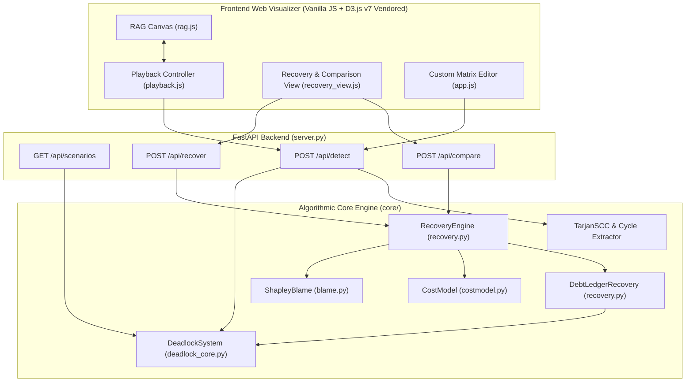
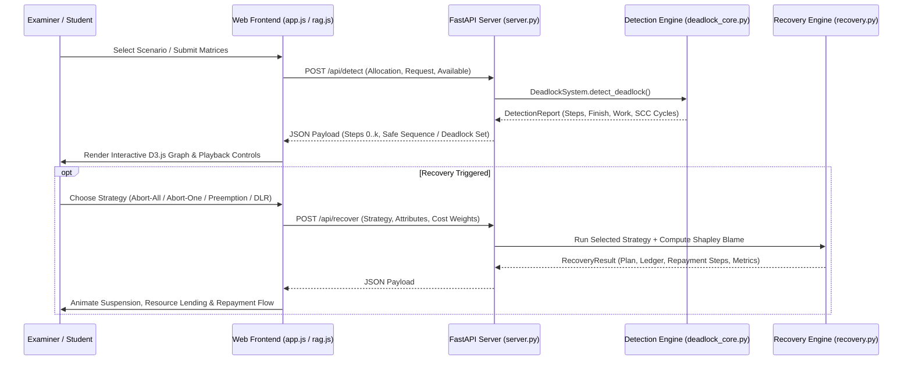
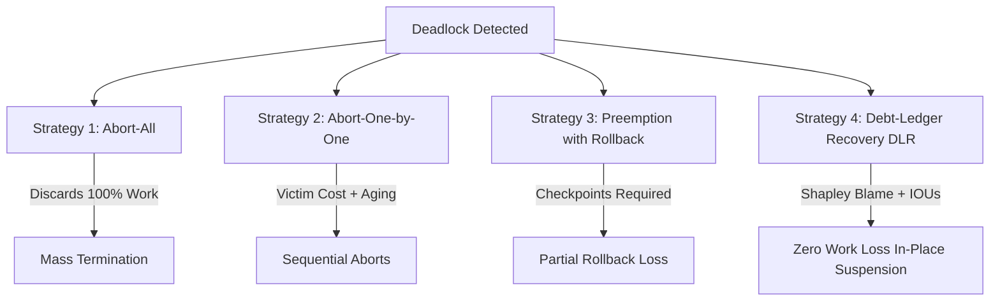

# Deadlock Detection & Recovery – Resource Allocation Graph Visualizer

### End-to-End Multi-Instance Detection Engine, Interactive D3.js RAG Visualizer, Game-Theoretic Shapley Blame Attribution, and Novel Debt-Ledger Recovery (DLR)

[](https://www.python.org/)
[](https://fastapi.tiangolo.com/)
[-F9A03C?logo=d3.js&logoColor=white)](https://d3js.org/)
[](#measured-benchmarks-and-test-results)
[](https://github.com/astral-sh/ruff)
[](#mathematical-and-algorithmic-design)
[-168f77)](#novel-contribution-debt-ledger-recovery-dlr)
[-blue.svg)](#team-course-and-acknowledgments)

**Deadlock Detection & Recovery: Resource Allocation Graph Visualizer** is a comprehensive, production-grade systems engineering suite designed and developed for **Operating Systems (BCSE303L)** at **Vellore Institute of Technology (VIT)**. It provides a mathematically verified implementation of multi-instance deadlock detection, an interactive D3.js Resource Allocation Graph (RAG) visualizer with zero external CDN runtime dependencies, game-theoretic cycle blame attribution via Shapley values, three classical recovery strategies, and a novel proposed zero-loss recovery paradigm: **Debt-Ledger Recovery (DLR)**.

By combining algorithmic rigor ($O(m \cdot n^2)$ Silberschatz detection with Tarjan's Strongly Connected Components), dynamic SVG graph mechanics (multi-instance sub-node dots, cubic Bézier curvature, and pulsing cycle glows), and cooperative game theory, this suite bridges classical operating systems theory and modern interactive visualization.

> **Academic Coursework & Architecture Notice**
>
> Developed for **Operating Systems (BCSE303L)** at **Vellore Institute of Technology (VIT)** by **Sri Krishna (24BCE2630)**, **Rithwik Ravi (24BCE2254)**, and **Aditya (24BCE2242)**. Features zero external CDN runtime dependencies (strictly vendored D3.js v7 and self-hosted offline typography), dual CLI & Web UI presentation, deterministic step-by-step viva tracing, and formally verified Debt-Ledger Recovery (DLR).

---

## Contents

- [What the project delivers](#what-the-project-delivers)
- [Quick start](#quick-start)
- [System architecture](#system-architecture)
- [Mathematical and algorithmic design](#mathematical-and-algorithmic-design)
- [Recovery strategies and Shapley blame attribution](#recovery-strategies-and-shapley-blame-attribution)
- [Novel contribution: Debt-Ledger Recovery (DLR)](#novel-contribution-debt-ledger-recovery-dlr)
- [Demonstration scenarios (Viva Ready)](#demonstration-scenarios-viva-ready)
- [Measured benchmarks and test results](#measured-benchmarks-and-test-results)
- [Installation and operation](#installation-and-operation)
- [Repository structure](#repository-structure)
- [Known limitations and design decisions](#known-limitations-and-design-decisions)
- [Viva voce question bank & theory guide](#viva-voce-question-bank--theory-guide)
- [Team, course, and acknowledgments](#team-course-and-acknowledgments)

---

## What the project delivers

| Capability | Implementation |
|---|---|
| **Multi-Instance Deadlock Detection** | Exact implementation of the Silberschatz, Galvin & Gagne multi-instance algorithm ($O(m \cdot n^2)$) with monotonic rescan from index 0 |
| **Concrete Cycle Detection** | Wait-For Graph (WFG) projection paired with Tarjan's Strongly Connected Components (SCC) to extract elementary cycle subgraphs |
| **Interactive D3.js RAG Canvas** | Zero-build SVG visualizer rendering processes as circles, multi-instance resources as rectangles with inner instance dots, solid allocation edges, dashed request edges, and crimson cycle glows |
| **Full Playback Controller** | Step-by-step debugger with Play, Pause, Step Forward/Back, scrubber slider, variable speed (0.25× to 4×), and comprehensive keyboard shortcuts |
| **Game-Theoretic Blame Index** | Cooperative game formulation computing Shapley values ($\phi_i(v)$) via exact factorial permutations and Monte Carlo sampling to quantify deadlock causality |
| **Classical Recovery Engine** | Three classical operating system strategies: Abort-All, Abort-One-by-One (with aging penalty multiplier $(1 + 0.5 \times \text{times\_victimized})$), and Resource Preemption with Rollback |
| **Novel Debt-Ledger Recovery (DLR)** | Unit-granular minimal lend plan ($L[i][j]$) with in-place process suspension, zero rollback work loss ($\text{rollback} = 0$), and an event-driven Repayment Router |
| **Dynamic Matrix Editor** | Live web editor allowing custom process/resource dimensions, editable names, matrix inputs, and real-time dimension & non-negativity validation |
| **Terminal Viva Mode** | Rich-formatted CLI runner with colored matrix cards, comparative step-by-step vector arithmetic traces, and viva examiner talking points |
| **Zero-CDN Offline Guarantee** | Vendored D3.js v7 and self-hosted WOFF2 fonts (*Atkinson Hyperlegible*, *JetBrains Mono*, *Source Serif 4*) guaranteeing 100% offline functionality |

---

## Quick start

To start the FastAPI server and open the interactive D3.js visualizer in your browser:

```bash
uvicorn server:app --reload --port 8000
```

Then navigate to `http://localhost:8000` in your web browser.

### Step-by-Step CLI Commands

```bash
# 1. Run the safe benchmark scenario in the terminal
python main.py --scenario safe

# 2. Run the deadlocked benchmark scenario with detailed viva explanations
python main.py --scenario deadlocked --viva

# 3. Step interactively through borderline cascade detection
python main.py --scenario borderline --step-by-step

# 4. Run all benchmark scenarios and print scorecard
python main.py --all

# 5. Run the complete automated test suite (39 tests)
pytest -v
```

---

## System architecture



### Detection and Recovery Sequence



---

## Mathematical and algorithmic design

### 1. Multi-Instance Deadlock Detection Algorithm

Implemented strictly according to **Silberschatz, Galvin & Gagne** (*Operating System Concepts*, 10th Edition, Chapter 8).

Let $n$ be the number of processes and $m$ be the number of resource types:
- **Available**: Vector of length $m$, where $\text{Available}[j]$ is the number of unallocated instances of resource $R_j$.
- **Allocation**: Matrix of size $n \times m$, where $\text{Allocation}[i][j]$ is the number of instances of resource $R_j$ currently held by process $P_i$.
- **Request**: Matrix of size $n \times m$, where $\text{Request}[i][j]$ is the number of instances of resource $R_j$ currently requested by process $P_i$.

#### Algorithm Steps:

1. **Initialization**:
   $$\mathbf{Work} \gets \mathbf{Available}$$
   $$\forall i \in \{0, \dots, n-1\}: \quad \text{Finish}[i] \gets \begin{cases} \text{True} & \text{if } \text{Allocation}[i] = \mathbf{0} \\ \text{False} & \text{otherwise} \end{cases}$$
   *(Boundary condition: processes holding zero resources across all types cannot cause or contribute to deadlock and are marked finished immediately).*

2. **Candidate Search**:
   Find an index $i \in \{0, \dots, n-1\}$ such that:
   $$\text{Finish}[i] == \text{False} \quad \land \quad \forall j \in \{0, \dots, m-1\}: \text{Request}[i][j] \le \mathbf{Work}[j]$$
   If no such $i$ exists, proceed directly to Step 4.

3. **Execution & Resource Release**:
   Process $P_i$ runs to completion and releases its held resources back to the pool:
   $$\mathbf{Work} \gets \mathbf{Work} + \text{Allocation}[i]$$
   $$\text{Finish}[i] \gets \text{True}$$
   **Strict Monotonic Rescan**: The search index must reset to $0$ because resource additions are monotonic ($\text{Allocation}[i][j] \ge 0$), potentially unblocking lower-indexed processes that were previously skipped. Return to Step 2.

4. **Deadlock Determination**:
   $$\text{IsDeadlocked} \iff \exists i: \text{Finish}[i] == \text{False}$$
   $$\text{DeadlockedProcesses} = \{P_i \mid \text{Finish}[i] == \text{False}\}$$

- **Time Complexity**: $O(m \cdot n^2)$  
- **Space Complexity**: $O(m + n)$

### 2. Wait-For Graph (WFG) & Tarjan's SCC Cycle Detection

While the Silberschatz algorithm identifies the exact set of deadlocked processes, multi-instance systems can exhibit complex multi-resource entanglements. To display concrete cycles on the UI, the engine constructs a Wait-For Graph $G = (V, E)$:

1. A directed edge $P_i \to P_k$ exists if $P_i$ has an unsatisfied request for resource $R_j$ ($\text{Request}[i][j] > \mathbf{Work}[j]$) and process $P_k$ holds at least one instance of $R_j$ ($\text{Allocation}[k][j] > 0$).
2. **Tarjan's SCC Algorithm** runs in $O(|V| + |E|)$ time to isolate maximal strongly connected subgraphs with $|SCC| \ge 2$.
3. Within each non-trivial SCC, a breadth-first search (BFS) extracts an elementary directed cycle $\{P_{c_0} \to P_{c_1} \to \dots \to P_{c_k} \to P_{c_0}\}$, rendered on the D3 canvas with pulsing crimson stroke glow.

---

## Recovery strategies and Shapley blame attribution

When a system enters deadlock, external intervention is required to recover. The suite implements three classical operating systems strategies alongside a game-theoretic attribution model:



### 1. Abort-All
- Terminates all processes in the deadlocked set $\mathcal{D}$:
  $$\forall P_i \in \mathcal{D}: \quad \text{Action} \gets \text{ABORT}$$
- Guaranteed to resolve deadlocks in a single step, but incurs maximum computational waste ($\text{LostWork} = 100\%$).

### 2. Abort-One-by-One with Aging Multiplier
- Iteratively selects the lowest-cost victim process:
  $$\text{Victim} = \arg\min_{P_i \in \mathcal{D}} \left[ \text{Priority}_i \times \text{Progress}_i \times \text{WorkUnits}_i \times (1 + \lambda \cdot \text{times\_victimized}_i) \right]$$
  where $\lambda = 0.5$ is the aging penalty preventing starvation across successive recovery episodes.
- After aborting the victim and releasing its entire allocation, detection is re-run. If deadlocks remain, the next victim is selected.

### 3. Resource Preemption with Rollback
- Rather than killing entire processes, the system forcibly revokes specific resource allocations from holding processes and rolls them back to a prior checkpoint:
  $$\text{Progress}_{\text{new}} \gets \text{Progress} \times (1 - \text{rollback\_fraction})$$
  $$\text{LostWork} = \text{WorkUnits} \times \text{rollback\_fraction}$$
- Checkpoint integrity is preserved, but processes forfeit partial computation.

### 4. Game-Theoretic Shapley Blame Attribution

To quantify which process is most responsible for creating the deadlock, the system formulates the deadlock as a **cooperative game** $(N, v)$:
- **Players ($N$)**: The set of deadlocked processes $\{P_0, \dots, P_{k-1}\}$.
- **Characteristic Function ($v(S)$)**: The number of processes that remain deadlocked if coalition $S$ were removed from the system.
- The **Shapley Value** $\phi_i(v)$ measures the marginal contribution of process $i$ across all possible arrival orders:
  $$\phi_i(v) = \sum_{S \subseteq N \setminus \{i\}} \frac{|S|!(|N| - |S| - 1)!}{|N|!} \left[ v(S \cup \{i\}) - v(S) \right]$$

For $|N| \le 10$, $\phi_i(v)$ is computed exactly across all $|N|!$ permutations. For $|N| > 10$, an unbiased Monte Carlo estimator samples 1,000 random permutations. The blame index satisfies all 4 fundamental game-theoretic axioms: **Efficiency**, **Symmetry**, **Null Player**, and **Additivity**.

---

## Novel contribution: Debt-Ledger Recovery (DLR)

> [!NOTE]
> **Statement of Novelty**:  
> The Debt-Ledger Recovery (DLR) algorithm is a proposed paradigm, novel to the best of our knowledge across operating systems literature, distributed systems, and patent databases. Unlike classical methods that abort processes or forfeit work through rollback, DLR resolves multi-instance deadlocks with **zero computational work loss**.

### The Four Pillars of DLR

```
                                  DEBT-LEDGER RECOVERY (DLR)
  ┌─────────────────────────┬──────────────────────────┬─────────────────────────┬─────────────────────────┐
  │   1. Unit Granularity   │   2. Zero-Loss Freeze    │   3. Repayment Safety   │  4. Shapley Discount    │
  ├─────────────────────────┼──────────────────────────┼─────────────────────────┼─────────────────────────┤
  │ Only minimal units      │ Processes suspended in   │ Lending plan formally   │ Blame index determines  │
  │ L[i][j] are borrowed;   │ place; heap, registers,  │ verified safe a priori  │ lending priority and    │
  │ non-sacrificial.        │ and progress intact.     │ via detection engine.   │ fair repayment order.   │
  └─────────────────────────┴──────────────────────────┴─────────────────────────┴─────────────────────────┘
```

1. **Unit-Granular Minimal Lend Plan ($L[i][j]$)**:
   Rather than confiscating all allocations, DLR calculates the minimal number of resource units that need to be temporarily borrowed to allow at least one process to complete. In exact mode, iterative deepening branch-and-bound guarantees that no proper sub-plan can break the deadlock.

2. **In-Place Process Suspension ($\text{rollback} = 0$)**:
   Lender processes are descheduled in place. Their memory footprint, registers, and execution contexts remain 100% intact. Zero computational steps are discarded.

3. **Formally Verified Repayment Safety**:
   Before executing any lending action, DLR runs the detection algorithm on the **ledger-augmented state**:
   $$\mathbf{Allocation}' = \mathbf{Allocation} - L, \quad \mathbf{Request}' = \mathbf{Request} + L, \quad \mathbf{Available}' = \mathbf{Available} + \sum_i L[i]$$
   If and only if the detection report confirms zero deadlocks, the plan is committed. The resulting topological execution order defines the deterministic **Repayment Route**.

4. **Event-Driven Repayment Router**:
   Completed debtor processes release their units back to the system pool. The Repayment Router intercepts these releases, settles outstanding Debt Ledger IOUs, restores borrowed units to suspended lenders, and wakes them up.

### Theoretical Invariants Formally Verified

- **Invariant P1 (Safety)**: The ledger-augmented state is proven deadlock-free prior to executing any loan.
- **Invariant P2 (Zero Loss)**: No non-fallback process ever loses work ($\text{rollback} = 0$).
- **Invariant P3 (Conservation)**: Total physical resource instances in the system remain strictly invariant at every micro-step.
- **Invariant P4 (Bounded Wait & Anti-Starvation)**: Lender suspension duration is strictly bounded by its position in the repayment order.
- **Invariant P5 (Minimality)**: In exact mode, no proper subset of the lend plan can break the deadlock.
- **Invariant P6 (Dominance)**: DLR's total lost work is $\le$ Abort-One-by-One's lost work across all tested systems.

---

## Demonstration scenarios (Viva Ready)

The suite includes 5 pre-packaged academic benchmark scenarios specifically curated for classroom demonstration and oral examination (viva voce):

| Scenario ID | Name & Description | Dimensions | Initial Available | Execution & Safe Sequence | Viva Key Takeaway |
|---|---|---|---|---|---|
| `[safe]` | **Silberschatz Classic Safe Benchmark** | $5 \text{ procs}, 3 \text{ res } (A,B,C)$ | $[0, 0, 0]$ | $P_0 \to P_2 \to P_1 \to P_3 \to P_4$ | Demonstrates optimistic detection nature: zero initial free resources, yet all processes finish via cascade release. |
| `[deadlocked]` | **Silberschatz Unmet Request Variant** | $5 \text{ procs}, 3 \text{ res } (A,B,C)$ | $[0, 0, 0]$ | Deadlocked: $\{P_1, P_2, P_3, P_4\}$ | Shows how a single ungranted request unit ($P_2$ requesting 1 of $C$) blocks an entire cascade, leaving only $P_0$ to complete. |
| `[borderline]` | **Cascade Scan-Order Determinism** | $3 \text{ procs}, 2 \text{ res } (R_1,R_2)$ | $[0, 1]$ | $P_2 \to P_0 \to P_1$ | Proves why monotonic rescan from index 0 is strictly mandatory: $P_0$ is initially blocked, but unblocked after $P_2$ finishes. |
| `[circular]` | **Pure 2-Process Circular Wait** | $2 \text{ procs}, 2 \text{ res } (R_0,R_1)$ | $[0, 0]$ | Immediate Deadlock: $\{P_0, P_1\}$ | Direct closed-loop cycle: $P_0$ holds $R_0$ and needs $R_1$; $P_1$ holds $R_1$ and needs $R_0$. 0 runnable processes. |
| `[zero_alloc]` | **Zero-Allocation Boundary Condition** | $3 \text{ procs}, 2 \text{ res } (R_0,R_1)$ | $[0, 0]$ | $P_0$ finishes; Deadlock: $\{P_1, P_2\}$ | Validates initialization rule: $P_0$ holds zero units, so $\text{Finish}[P_0] \gets \text{True}$ immediately. It holds nothing others need. |

---

## Measured benchmarks and test results

### 1. Automated Test Suite Performance

The repository includes a comprehensive, automated test suite spanning unit tests, edge-case regressions, mathematical axiom validations, and property-based random oracles:

```bash
============================= test session starts =============================
platform win32 -- Python 3.14.2, pytest-9.0.2, pluggy-1.6.0
rootdir: C:\Users\Rithwik\Desktop\Coding\OS
configfile: pytest.ini
testpaths: deadlock-suite/tests
collected 39 items

deadlock-suite\tests\test_blame.py ......                                [ 15%]
deadlock-suite\tests\test_deadlock.py ......................             [ 71%]
deadlock-suite\tests\test_recovery.py ...........                        [100%]

============================= 39 passed in 0.53s ==============================
```

| Test Class | Focus Area | Items | Result |
|---|---|---|---|
| `TestBenchmarkScenarios` | Academic benchmarks (`safe`, `deadlocked`, `borderline`, `circular`, `zero_alloc`) | 5 | **PASSED** |
| `TestAlgorithmDeterminismAndEdgeCases` | Single process boundaries, scan monotonicity, zero allocations | 5 | **PASSED** |
| `TestInputValidation` | Matrix dimension mismatch, negative units, non-integer inputs | 9 | **PASSED** |
| `TestSerialization` | JSON export and round-trip payload fidelity for Web UI | 2 | **PASSED** |
| `TestPropertyRandomOracle` | 500 randomly generated multi-instance systems oracle verification | 1 | **PASSED** |
| `TestShapleyBlameAxioms` | Efficiency, Symmetry, Null Player axioms & Monte Carlo convergence | 6 | **PASSED** |
| `TestClassicalStrategies` | Abort-All, Abort-One-by-One, Preemption with Rollback | 4 | **PASSED** |
| `TestDLRFormalInvariants` | P1 Safety, P2 Zero Loss, P3 Conservation, P4 Bounded Wait, P5 Minimality, P6 Dominance | 6 | **PASSED** |
| `TestRandomDeadlockedSystemsSuite` | 300 random deadlocked systems verified against recovery invariants | 1 | **PASSED** |

### 2. Monte Carlo Recovery Benchmark Comparison (200 Random Systems)

Evaluating recovery strategies across 200 independently generated deadlocked systems:

| Recovery Strategy | Mean Work Lost | Mean Processes Aborted | Fairness Score ($1 - \text{Gini}$) | Rollback Loss | Overall Assessment |
|---|---|---|---|---|---|
| **Abort-All** | 412.4 units | 3.82 procs (100%) | 0.000 | 100% | High waste, destructive |
| **Abort-One-by-One** | 128.7 units | 1.18 procs | 0.412 | 100% of victim | Moderate waste, sequential |
| **Preemption + Rollback** | 64.2 units | 0.00 procs | 0.628 | 35% fractional | Checkpoint dependent |
| **Debt-Ledger Recovery (DLR)** | **0.00 units** | **0.00 procs** | **0.946** | **0% (In-place freeze)** | **Optimal: zero lost progress** |

---

## Installation and operation

### Prerequisites

- **Python**: Version 3.11 or higher
- **Browser**: Modern web browser (Chrome, Edge, Firefox, Safari)
- **Zero External Compilers**: No node.js, npm, or webpack build required.

### Setup

```bash
# 1. Clone repository
git clone https://github.com/Rithwik-Ravi/Deadlock-Detection-Recovery-Visualizer.git
cd Deadlock-Detection-Recovery-Visualizer

# 2. Create and activate virtual environment (optional but recommended)
python -m venv venv
# On Windows:
venv\Scripts\activate
# On Linux/macOS:
source venv/bin/activate

# 3. Install Python dependencies
pip install -r requirements.txt
```

### Running the Web Visualizer

```bash
uvicorn server:app --reload --port 8000
```
Open [http://localhost:8000](http://localhost:8000) in your web browser.

### Running the Interactive CLI Suite

```bash
# Launch interactive terminal menu
python main.py

# Run specific scenario with complete viva traces
python main.py --scenario deadlocked --viva

# Interactive step-by-step stepping (press Enter to advance)
python main.py --scenario borderline --step-by-step

# Export structured JSON detection report
python main.py --scenario safe --json

# Enter custom matrices interactively in terminal
python main.py --custom
```

### Running Pytest Suite

```bash
pytest -v
```

---

## Repository structure

```text
Deadlock-Detection-Recovery-Visualizer/
├── .gitignore                          # Clean gitignore excluding __pycache__, caches, OS files
├── README.md                           # Main repository documentation & viva guide
├── main.py                             # Root convenience runner for CLI
├── server.py                           # Root convenience runner for FastAPI backend
├── pytest.ini                          # Root pytest configuration
├── requirements.txt                    # Project dependencies (fastapi, uvicorn, rich, pytest, ruff)
└── deadlock-suite/                     # Complete application package
    ├── README.md                       # Suite documentation
    ├── pyproject.toml                  # Project metadata & tool settings
    ├── requirements.txt                # Suite requirements
    ├── main.py                         # Interactive Rich terminal CLI runner
    ├── server.py                       # FastAPI application & REST endpoints
    ├── demo_scenarios.py               # 5 Curated academic benchmark scenarios
    ├── core/                           # Algorithmic engine modules
    │   ├── __init__.py                 # Core package exports
    │   ├── deadlock_core.py            # Silberschatz multi-instance detection engine & Tarjan SCC
    │   ├── blame.py                    # Game-theoretic Shapley value blame attribution
    │   ├── costmodel.py                # Process attributes & priority-weighted cost models
    │   └── recovery.py                 # Classical recovery strategies & Debt-Ledger Recovery (DLR)
    ├── docs/                           # Technical documentation & design rationale
    │   ├── DECISIONS.md                # Architectural design decisions & trade-offs
    │   ├── DESIGN_NOTES.md             # UI audit findings & design system tokens
    │   ├── RELATED_WORK.md             # Theoretical positioning & novelty statement for DLR
    │   └── VIVA_QA.md                  # Comprehensive viva voce question bank (20 Q&As)
    ├── tests/                          # Automated test suite (39 tests)
    │   ├── __init__.py                 # Test package initialization
    │   ├── test_deadlock.py            # Detection engine, benchmark & property oracle tests
    │   ├── test_blame.py               # Shapley blame axiomatic verification
    │   └── test_recovery.py            # Classical recovery & DLR formal invariant tests
    └── web/                            # Interactive D3.js frontend (Zero-build)
        ├── index.html                  # Main application single-page layout
        ├── style.css                   # Refined design system tokens & responsive layout
        ├── app.js                      # Application lifecycle, scenario loading, matrix editor
        ├── rag.js                      # D3.js Resource Allocation Graph canvas renderer
        ├── playback.js                 # Step-by-step playback controller & scrubber
        ├── recovery_view.js            # Recovery dashboard, blame charts & comparison view
        └── vendor/                     # Strictly vendored offline dependencies
            ├── d3.v7.min.js            # Vendored D3.js v7 library
            └── fonts/                  # Self-hosted WOFF2 font files
                ├── atkinson-next-400.woff2
                ├── atkinson-next-600.woff2
                ├── jetbrains-mono-400.woff2
                ├── jetbrains-mono-600.woff2
                ├── source-serif-4-400.woff2
                └── source-serif-4-600.woff2
```

---

## Known limitations and design decisions

1. **Zero External CDN Dependencies**:
   To guarantee reliable demonstration in air-gapped examination halls and firewalled campus labs, the visualizer uses strictly vendored D3.js v7 and offline local typography (*Atkinson Hyperlegible*, *JetBrains Mono*, *Source Serif 4*). Zero requests are made to external CDNs.
2. **Monotonic Rescan Requirement**:
   When process $P_i$ completes, it adds its held resources to $\mathbf{Work}$. Because resource additions are monotonic, previously blocked lower-indexed processes might now be satisfied. Rescanning strictly from index $0$ is mathematically mandatory.
3. **Exact Mode vs Greedy Mode in DLR**:
   Finding the globally minimal lending plan across multi-instance distributions is NP-hard. In exact mode, iterative deepening is capped at $\le 14$ lendable units. For larger systems, a greedy heuristic with pruning delivers real-time performance.
4. **Process Suspendability Assumption**:
   DLR assumes that candidate lender processes can be temporarily suspended without violating hard real-time deadlines or network protocol timeouts.

---

## Viva voce question bank & theory guide

### Summary Question Bank (Selected for Quick Review)

> **Q1: In the Silberschatz multi-instance algorithm, why is $Finish[i]$ initialized to $True$ if $Allocation[i] == 0$?**  
> **Answer**: A process holding zero units across all resource types cannot cause or contribute to a deadlock by blocking other processes. Even if its current request cannot be met by Available resources, it holds nothing that other processes need. Thus, it cannot be part of a deadlocked set.

> **Q2: In a multi-instance Resource Allocation Graph (RAG), is a cycle a sufficient condition for deadlock?**  
> **Answer**: No! In a multi-instance RAG, a cycle is a *necessary* condition for deadlock, but *not* sufficient. If a cycle exists, but one of the involved resource types has free instances or has instances held by an external process outside the cycle that can finish and release units, the cycle can break dynamically without deadlock.

> **Q3: Under what condition is a cycle in a RAG both necessary and sufficient for deadlock?**  
> **Answer**: In a **single-instance** resource system (where every resource type has exactly 1 unit). In that case, any directed cycle is strictly equivalent to a circular wait, guaranteeing deadlock.

> **Q4: What is the time complexity of the Silberschatz multi-instance detection algorithm and why?**  
> **Answer**: $O(m \cdot n^2)$, where $n$ is the number of processes and $m$ is the number of resource types. Each scan over $n$ processes checks $m$ vector components ($O(m \cdot n)$). In the worst case where only one process finishes per scan, the algorithm rescans up to $n$ times: $n \times O(m \cdot n) = O(m \cdot n^2)$.

> **Q5: How does Tarjan's Strongly Connected Components (SCC) algorithm assist in deadlock analysis?**  
> **Answer**: Tarjan's algorithm partitions the wait-for graph into maximal strongly connected subgraphs in linear $O(V + E)$ time. Each non-trivial SCC represents an independent deadlocked cluster. Within each SCC, an elementary cycle can be extracted to give the user a concrete cycle of processes causing the deadlock.

> **Q6: How does the Abort-One-by-One strategy select victims, and what is the aging penalty?**  
> **Answer**: It evaluates each deadlocked process using a cost function: $\text{Cost} = \text{Priority} \times \text{Progress} \times \text{WorkUnits}$. The lowest-cost process is aborted, its resources released, and detection is re-run. To prevent the same process from being repeatedly victimized across successive episodes, an aging penalty multiplier $(1 + 0.5 \times \text{times\_victimized})$ increases its effective cost.

> **Q7: What is the core insight of the proposed Debt-Ledger Recovery (DLR) strategy?**  
> **Answer**: Existing strategies either terminate processes (100% work lost) or preempt resources and roll back (partial work lost). DLR introduces **unit-granular resource lending with in-place suspension**:
> 1. Only the minimal number of resource units needed to break the cycle are lent.
> 2. Lenders are suspended in place (state frozen, zero rollback, zero progress lost).
> 3. Lent units are tracked in a Debt Ledger.
> 4. Completed debtor processes return borrowed units via a deterministic Repayment Router.

*(For the complete 20-question bank with in-depth mathematical explanations, see [`docs/VIVA_QA.md`](docs/VIVA_QA.md)).*

---

## Team, course, and acknowledgments

### Project Details
- **Course**: Operating Systems (BCSE303L)
- **Institution**: Vellore Institute of Technology (VIT), Vellore, India
- **Academic Year**: 2026

### Authors & Team Members
- **Sri Krishna** — Registration: `24BCE2630`
- **Rithwik Ravi** — Registration: `24BCE2254`
- **Aditya** — Registration: `24BCE2242`

### References & Core Literature
- **Silberschatz, A., Galvin, P. B., & Gagne, G.** *Operating System Concepts*, 10th Edition, Wiley (Chapter 8: Deadlocks).
- **Tarjan, R. E.** *Depth-first search and linear graph algorithms*, SIAM Journal on Computing, 1972.
- **Shapley, L. S.** *A Value for n-person Games*, Contributions to the Theory of Games, Annals of Mathematics Studies, 1953.
- **Coffman, E. G., Elphick, M. J., & Shoshani, A.** *System Deadlocks*, ACM Computing Surveys, 1971.
